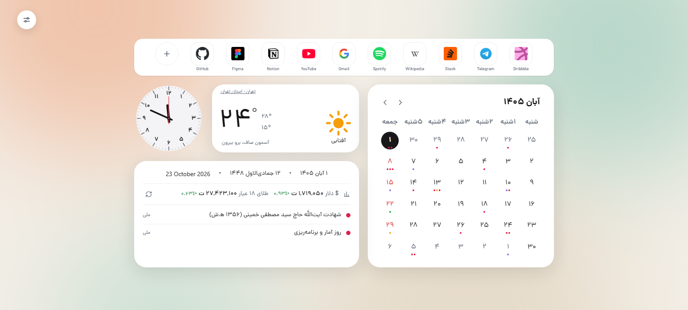
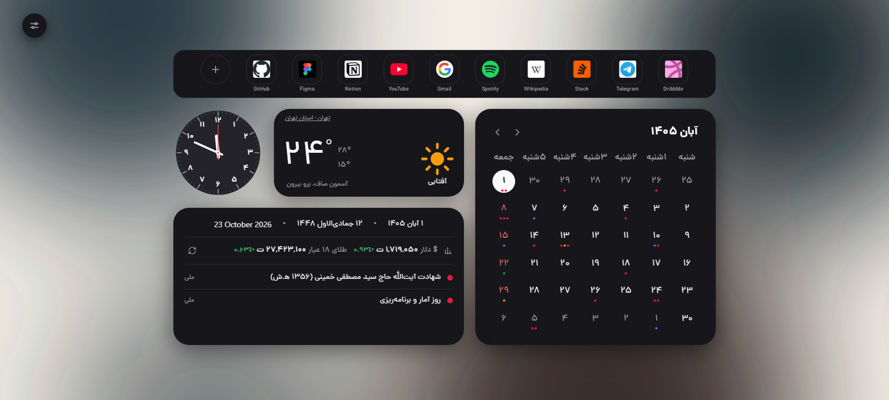
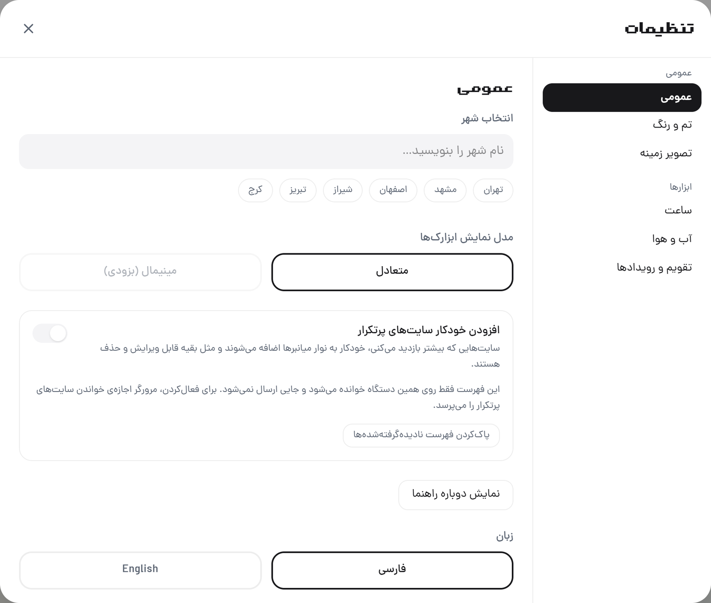

# روزنه (Rozaneh)
Copy from [Rooza](https://chromewebstore.google.com/detail/rooza/cclmobdmakfgnpnnibjfcgkinmejblej)

A light, private new-tab extension for Chrome and Firefox: analog/digital clock,
tri-calendar (Jalali / Hijri / Gregorian), Iranian occasions, prayer times,
weather, USD/gold prices, and a single-row shortcut bar. Persian-first RTL UI
with an English toggle. Built with WXT, Svelte 5, TypeScript, and Tailwind CSS
v4.

## Preview

  

  
  

*Screenshots use demo shortcuts, demo weather/price data and a demo wallpaper;
no personal browsing data is shown.*

Permissions: `storage` and `favicon`; optional `bookmarks` (bookmark import)
and optional `topSites` (most-visited suggestions), both requested at runtime
only after the user opts in. The extension never requests full browsing history.

Privacy: shortcut, bookmark and most-visited lists stay on your device. Icons
come from the browser's local favicon store, with the site's own
`/favicon.ico` as a fallback. Weather sends the selected coordinates to
Open-Meteo, and city search sends the typed place name to Open-Meteo's
geocoding endpoint; neither request includes an identifier. See
[PRIVACY.md](./PRIVACY.md).

## Shortcuts

The new-tab search field has been removed. The top card is a single-row
shortcut bar of larger tiles, plus add/edit/remove/drag support. It shows at
most 11 shortcuts and the add button; when the row is full the add button
disappears. If you enable most-visited suggestions, sites you visit often are
appended automatically after your manual shortcuts; they remain
editable/removable, and a removed suggestion is remembered so it does not come
back.

## Toolbar popup

Clicking the extension icon opens a compact popup with:

- an on/off switch for the Rozaneh new-tab dashboard,
- the light/dark/auto theme switch,
- the optional most-visited shortcut toggle,
- shortcuts to Settings and the welcome guide.

## Contributing

Development setup, building, the agent skill, and store publishing instructions
live in [CONTRIBUTING.md](./CONTRIBUTING.md).
